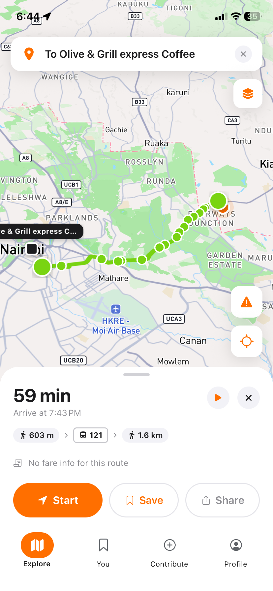
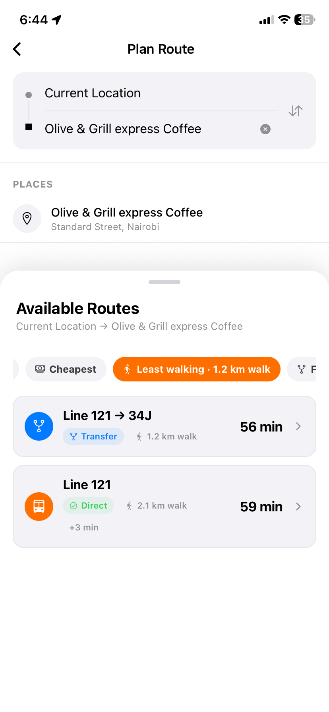
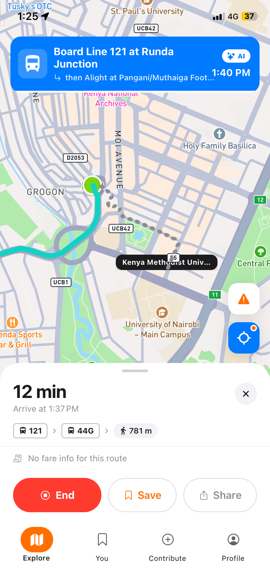
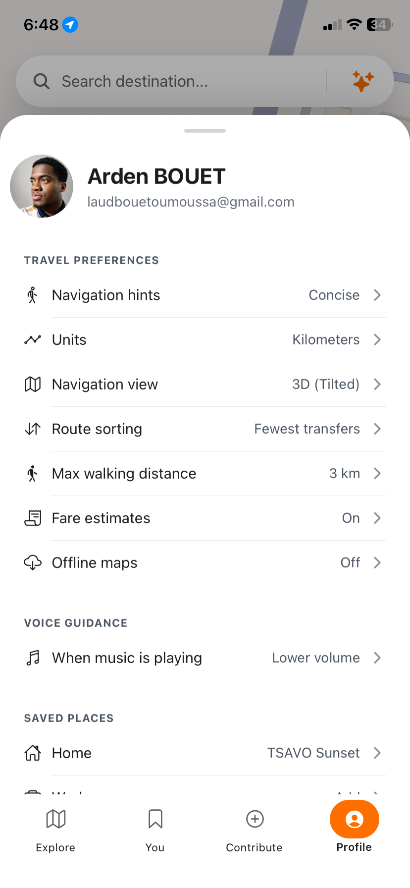

<div align="center">

# Navigo

**Real-time public-transport navigation for Nairobi's matatu and bus network.**

---

[](https://expo.dev)
[](https://reactnative.dev)
[](https://mapbox.com)
[](https://typescriptlang.org)
[](https://expo.dev)
[](https://github.com/Navigo-Kenya/navigo)
[](LICENSE)

</div>

---

## Screenshots

<div align="center">

| Route Preview | Plan a Trip |
|:---:|:---:|
|  |  |
| **Live Navigation** | **Profile & Preferences** |
|  |  |

</div>

---

## Overview

Navigo is the passenger-facing mobile app for Nairobi's informal matatu/bus network, a full journey-planning and live navigation experience built specifically for the city's fill-and-go transit reality.

It covers the complete commute loop: search → plan → navigate → contribute, with an AI assistant (Kwame), gamified crowdsourcing, and a projection-based navigation engine that handles the fill-and-go reality of Nairobi transit better than schedule-only approaches.

---

## Features

### Journey Planning
- **Multi-itinerary planner**, up to 5 route alternatives ranked by fastest / cheapest / least walking / fewest transfers
- **Kwame AI assistant**, Gemini-powered conversational trip planner with voice input (VAD auto-stop), Google Cloud TTS response, and persistent session memory
- **In-trip copilot**, Kwame answers live trip questions ("how many stops left?") using real-time navigation context
- **Safety scoring**, night-time itineraries scored by walk distance after dark + nearby hazard reports; safer route flagged
- **Route preview fly-through**, animated camera sweep along the full polyline before starting
- **Landmark-anchored guidance**, "Walk to Koja, opposite Masinde Muliro University", "Alight at Westlands, just after Oryx Energies", "Turn left after Java House": landmarks from the API's `LandmarkService`, in every mode

### Navigation Engine
- **Projection-based** (not proximity-based), projects GPS onto route polyline for accurate progress, ETA, and step detection; handles loops and U-turns correctly
- **EMA smoothing**, location (α=0.3), heading (α=0.7), speed (α=0.5) with circular-arithmetic heading interpolation
- **Off-route detection**, 3 consecutive strikes > 45 m from line; recovers automatically
- **Dead reckoning**, advances position estimate during GPS gaps (< 30 m/s clamp)
- **High-water-mark anti-backward-snap**, GPS bounce never rewinds progress
- **Adaptive GPS accuracy**, cell-tower quality for browsing, balanced GPS during navigation

### Live Navigation UI
- **Voice guidance**, expo-speech with ducking/pause/mix prefs and earpiece routing (Android)
- **Haptic feedback**, step advance (medium impact) and arrival (success notification)
- **`In X m` distance countdown**, tiered pre-announcement (far / near / imminent)
- **Live Activity**, 3-tier router: iOS ActivityKit (`navigo-live-activity` Expo Module, Dynamic Island) → Android notifee real progress bar notification → expo-notifications fallback
- **Pause / resume**, freezes engine and mutes voice; banner shows paused state
- **Native puck + camera**, `CustomLocationProvider` + `LocationPuck` (puckBearing: course) with JS glide fallback via `prefs.nativeFollow`
- **Geofenced alight alarm**, `expo-task-manager` background task fires at alight stop (180 m) and destination (120 m) even when app is killed
- **Live ride feed**, the banner shows "Passing Naivas · on your left", then "Next: Meditest Hospital · 400 m", and two stops out "Alight at Westlands, just after Oryx Energies" (also spoken); the journey's landmarks are named on the map, the one to get off at ringed

### Map
- **Mapbox GL**, custom style, stable camera with movement/heading thresholds
- **Progressive stop rendering**, hidden below zoom 13; radius scales 2–12 km; selected stop always visible
- **AR walking guidance**, expo-camera full-screen overlay with bearing arrow, aligned ±15° haptic snap (Phase 2)
- **Offline vector packs**, Mapbox TileStore packs (z10–16), replaces legacy raster downloader
- **Real-time reports**, crowdsourced hazard/delay pins within viewport
- **Our own places (POIs)**, Overture Maps places served as vector tiles by the API (`PoiLayer`), replacing Mapbox's: 17 category badges, names from zoom 16, landmarks only during navigation
- **Category search**, chips (Restaurant, Fuel, Hospital…) list the nearest places of that category and pin them on the map; header chips switch category; "Search this area" after panning
- **Place details**, tapping a place glides the camera to it, enlarges and names it (`SelectedPlaceLayer`), and opens the place sheet with live Google details (photos with credits, rating, hours, phone, website)
- **Stop sheet**, a `MapSheet` like the place sheet: stop-type badge, community rating, next departure, live arrivals (30 s refresh), info, reviews, and review / suggest-an-edit / report-a-delay forms
- **Real stop types**, stops show what they are (bus, terminal, rail, metro, BRT, ferry, tram, airport, cable) everywhere they are listed (`StopTypeBadge`)

### Community & Gamification
- **Contributions**, stop edits, photos, delay reports, reviews with moderation queue
- **Points + badges**, awarded on approval with animated `BadgeUnlockModal` (spring entrance, auto-dismiss 3.2 s)
- **Streak tracking**, daily streak flame 🔥 on level card; 19:00 local reminder when streak is active but not yet contributed today
- **Leaderboard**, weekly / all-time tabs
- **Landmark boarding**, "in front of Hilton" sub-line on boarding steps when approved landmark data exists

### Platform
- **Auth**, email/password, Google OAuth, Apple Sign-In, phone OTP
- **Saved places + journeys**, home/work pins synced to widget bridge
- **Quick Actions**, "Go home", "Go to work", "Ask Kwame" app shortcuts (Phase 2)
- **Morning briefing push**, 06:30 EAT daily (weather + route + active reports)
- **Home-screen widget bridge**, `widgetBridge.ts` syncs home/work/streak to AsyncStorage + native shared container (App Group / SharedPreferences) for WidgetKit / Glance widgets
- **Session replay harness**, dev-only trace recorder + replay screen for NavigationEngine golden-trace fixtures
- **Nav metrics telemetry**, batched `POST /telemetry/nav-metrics` (reroute, snap_rate, arrival_precision, etc.)
- **Sentry**, `@sentry/react-native` wired in `_layout.tsx`; inert until `EXPO_PUBLIC_SENTRY_DSN` is set (Phase 2 build)

---

## Design System

### Icons (`components/icons/`)

Navigo uses its **own icon set**, never stock icon fonts in new code.

| File | What |
|------|------|
| `glyphs.ts` | The 81 UI icons as plain path data (24-unit grid, rounded 1.9 strokes), shared by the app and the gallery |
| `Icon.tsx` | `<Icon name="star-outline" size={16} color={...} />`, a drop-in for `<Ionicons>` (same props and names) |
| `NavigoIcons.tsx` | Map and category glyphs: map layers, report, place categories, stop types (`StopTypeGlyph`), POI categories (`PoiCategoryGlyph`) |
| `poiCategories.ts` | POI category labels and colours (mirrors the API's `config/pois.php`) |
| `reportIcons.ts` | Community report icons (pre-rendered PNGs) |

Variants: a name ending in `-outline` draws the line style; the plain name draws the filled style, duotone (18% tint) or solid for stars, pins, bookmarks and status circles, with details knocked out in white. A name without a Navigo glyph falls back to Ionicons and warns in development, so add the glyph to `glyphs.ts`.

Map badges (stop types, POI categories, reports) are pre-rendered PNGs in `assets/images/{stops,pois,reports}/` (@1x/@2x/@3x).

**Gallery:** every icon and badge on one page for design review:

```bash
node scripts/icon-gallery.ts icon-gallery.html   # Node 23.6+ runs TypeScript directly
```

### Sheets

`components/app/MapSheet.tsx` is the base for every sheet over the map (snap points, velocity throw, sticky footer, back button); floating map controls follow its top edge (`mapSheetInsets.ts`). Contribution forms use `components/app/stop/FormSheet.tsx` (keyboard-aware bottom sheet with a sticky submit).

---

## App Structure

Uses **expo-router** file-based routing. All screens live under `app/`.

```
app/
├── _layout.tsx               # Root: auth gate, Sentry init, quick-actions
├── (tabs)/
│   ├── map.tsx               # Main map: stops, navigation, AR entry
│   ├── search.tsx            # Journey search with Mapbox geocoding fallback
│   ├── contribution.tsx      # Contribute: stop edits, photos, reports, reviews
│   ├── favorite.tsx          # Saved places + journeys
│   └── profile.tsx           # Settings, preferences, account
├── (account)/
│   ├── leaderboard.tsx       # Weekly / all-time leaderboard
│   ├── notifications.tsx     # Notification preference toggles
│   ├── kwame-memory.tsx      # View / delete Kwame's persistent memory
│   ├── offline-maps.tsx      # Offline vector pack manager
│   ├── dev-replay.tsx        # Session replay (dev only, hidden behind tap×7)
│   └── ...
├── journey.tsx               # Route alternatives + tradeoff chips
└── kwame.tsx                 # Full Kwame AI chat screen (voice + text)
```

---

## Architecture

### Navigation Engine (`services/navigationEngine.ts`)

Projection-based engine, the core of live navigation.

```
GPS fix → EMA smooth → projectUser() → EngineResult
                                            │
                         ┌──────────────────┴──────────────────┐
                         │                                     │
                  progress metrics                         step logic
                  (confirmedOffset,               (nextStepIdx, approachPhase,
                   remainingDistanceM,             distanceToNextStepM,
                   routeFraction)                  stopsRemaining)
```

Key design decisions:
- Local search window (±150 m / 500 m of last position), avoids full-scan on every tick
- Bus-mode off-route override, transit legs never trigger off-route (driver controls path)
- High-water mark, `confirmedOffset` only advances, never rewinds

### Global State (Zustand)

| Store | Purpose |
|-------|---------|
| `journeyStore.ts` | Active journey (`fromLoc`, `toLoc`, `route`), `TripStatus` state machine |
| `navStateStore.ts` | Live trip mirror (instruction, ETA, stops remaining, line), fed from `useNavigation`, read by Kwame copilot |
| `contributionStore.ts` | Contributions list, community stats, badges; syncs streak to widget bridge |
| `savedStore.ts` | Saved places + journeys; syncs home/work to widget bridge |
| `prefsStore.ts` | Route ranking, voice prefs, nav follow mode, dev flags |
| `offlineMapStore.ts` | Mapbox pack metadata |

### Services

| Service | Purpose |
|---------|---------|
| `navigationEngine.ts` | Projection engine, pure TS, fully unit-tested |
| `liveActivity.ts` | 3-tier Live Activity router (ActivityKit stub / Android notification / fallback) |
| `voiceGuide.ts` | expo-speech wrapper with ducking, earpiece routing, tiered announcements |
| `alightGeofence.ts` | Background geofence task for alight/arrival notifications |
| `offlinePacks.ts` | Mapbox TileStore pack management |
| `widgetBridge.ts` | AsyncStorage widget data bridge (home/work/streak) for Phase 3 native widgets |
| `navMetrics.ts` | Nav session telemetry buffer + flush |
| `traceRecorder.ts` | Dev-only GPS trace recorder for golden-trace test fixtures |
| `quickActions.ts` | expo-quick-actions app shortcuts (Phase 2) |
| `contribution.ts` | Community API client (contributions, stats, badges, leaderboard) |
| `user.ts` | Auth + profile + saved places/journeys API client |
| `ai.ts` | Kwame / AiService, `planRoute`, session context, nav context injection |
| `apiClient.ts` | Axios instance; base URL from `EXPO_PUBLIC_API_URL` |
| `poi.ts` | Place details (`/pois/{id}`, live Google content), nearby POIs by category, photo URLs |
| `exploreSearch.ts` | Text search (places + stops + lines) and category search into the results sheet |

### Hooks

| Hook | Purpose |
|------|---------|
| `useNavigation.ts` | Orchestrates the full nav loop: GPS → engine → voice → live activity → metrics |
| `useAiVoice.ts` | Kwame voice-mode: VAD recording, TTS playback, streaming captions |
| `useStopSearch.ts` | Backend search → Mapbox geocoding fallback (< 3 local results) |
| `useRouteOverlay.ts` | Derives Mapbox layer sources from journey route |
| `useMapCamera.ts` | Camera follow / overview logic |
| `useHeadingTracker.ts` | Smoothed device heading for AR overlay |
| `useRatePrompt.ts` | Post-journey rating nudge |

### Utils

| Util | Purpose |
|------|---------|
| `landmarks.ts` | Landmark guidance helpers: `withLandmark` (no duplicated names), `progressAlong` (metres along a leg), `rideCue` (passing / next / alight cue) |
| `departures.ts` | Departure metadata and no-departure copy |
| `mapHelpers.ts` | ETA and duration formatting (70-minute rule), step types, maneuvers |
| `rankRoutes.ts` | Route ranking criteria |

---

## Getting Started

### Prerequisites

| Requirement | Notes |
|-------------|-------|
| Node.js 18+ | |
| Expo SDK 54 | `npx expo install --check` |
| Android Studio | For Android emulator / `expo run:android` |
| Xcode | For iOS simulator / `expo run:ios` |
| Mapbox token | Map tiles + Directions API |
| Running `navigo-api` | See [navigo-api/README.md](../navigo-api/README.md) |

### Install

```bash
cd navigo
npm install
```

### Environment

Create `navigo/.env`:

```env
APP_ENV=development

# Mapbox
EXPO_PUBLIC_MAPBOX_TOKEN=pk.your_public_token
EXPO_PUBLIC_MAPBOX_STYLE_URL=mapbox://styles/...
RNMAPBOX_MAPS_DOWNLOAD_TOKEN=sk.your_downloads_token   # SDK download during native build

# API
EXPO_PUBLIC_API_URL=http://localhost:8000/api/v1        # use ngrok for physical device

# Sentry (optional, inert without DSN)
EXPO_PUBLIC_SENTRY_DSN=
```

### Run

```bash
npx expo start            # Expo Go / dev build via QR
npx expo run:android      # Android emulator or device (native build)
npx expo run:ios          # iOS simulator or device (native build)
```

> **Physical device**: set `EXPO_PUBLIC_API_URL` to an externally reachable URL (e.g., ngrok tunnel to `localhost:8000`).

### Lint & Type-check

```bash
npx expo lint
npx tsc --noEmit
```

### Tests

```bash
npm test                  # jest + jest-expo
npm test -- --watch       # watch mode
```

Test coverage:
- `services/__tests__/navigationEngine.test.ts`, projection, off-route, dead reckoning, arrival (3 synthetic golden-trace fixtures)
- `utils/__tests__/rankRoutes.test.ts`, route ranking criteria
- `utils/__tests__/landmarks.test.ts`, landmark phrasing, progress along a leg, ride feed cues
- `utils/__tests__/mapHelpers.test.ts`, ETA and duration formatting

---

## Native Rebuild Notes

Some features require a native build (not OTA-updatable):

| Feature | Status | Build needed |
|---------|--------|-------------|
| AR walking guidance (`expo-camera`) | Code shipped | `expo run:android` / EAS |
| App shortcuts (`expo-quick-actions`) | Code shipped | `expo run:android` / EAS |
| Sentry native crash reporting | Code shipped | `expo run:android` / EAS |
| iOS ActivityKit Live Activities | Code shipped | `eas build --profile production` + Apple Developer |
| iOS WidgetKit home-screen widget | Code shipped | `eas build --profile production` + Apple Developer |
| Android Glance widget | Code shipped | `eas build --profile production` |
| Android notifee progress notification | Code shipped | `eas build --profile production` |

One rebuild activates AR, quick-actions, and Sentry together:

```bash
npx expo prebuild --clean
npx expo run:android    # or EAS build
```

---

## Roadmap

See [Navigo.md](../Navigo.md) for the full 20-feature roadmap with per-item status (☑ shipped · ◐ partial · ☐ not started).

| Phase | Status | Ship vehicle |
|-------|--------|-------------|
| 1, Pure JS/PHP | ☑ Shipped | OTA + API deploy |
| 2, First native rebuild | ☑ Code shipped | Needs one `expo prebuild` + build |
| 3, Extension targets (ActivityKit, WidgetKit, Glance) | ☑ Code shipped | `eas build --profile production` + Apple Developer |
| 4, Product polish | ☑ Shipped | OTA + API deploy |

---

## Contributing

1. Fork and create a feature branch
2. `npx tsc --noEmit` and `npm test` must pass before opening a PR
3. Navigation engine changes must include or update golden-trace fixtures in `services/__tests__/fixtures/`
4. Use conventional commits: `feat:` / `fix:` / `perf:` / `refactor:`
5. Use `<Icon>` from `@/components/icons/Icon`, not `@expo/vector-icons`; add missing glyphs to `glyphs.ts` and check them in the gallery
6. Map layers inside a `ShapeSource` / `VectorSource` must be direct children (no fragments), and `["zoom"]` may only be the input of a top-level `interpolate` / `step`

---

<div align="center">

Built for Nairobi's commuters.

</div>
